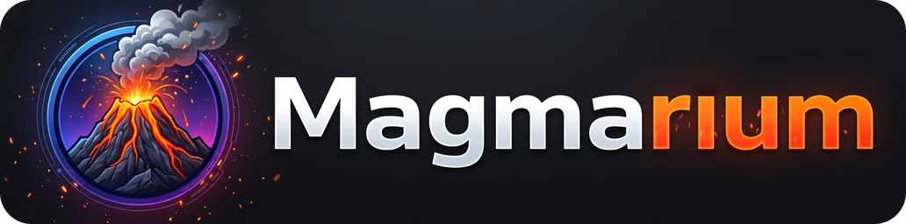
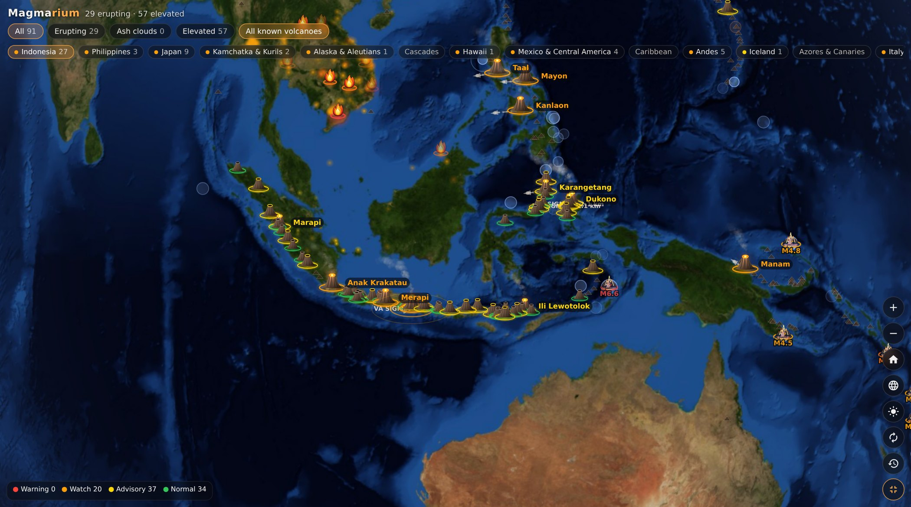
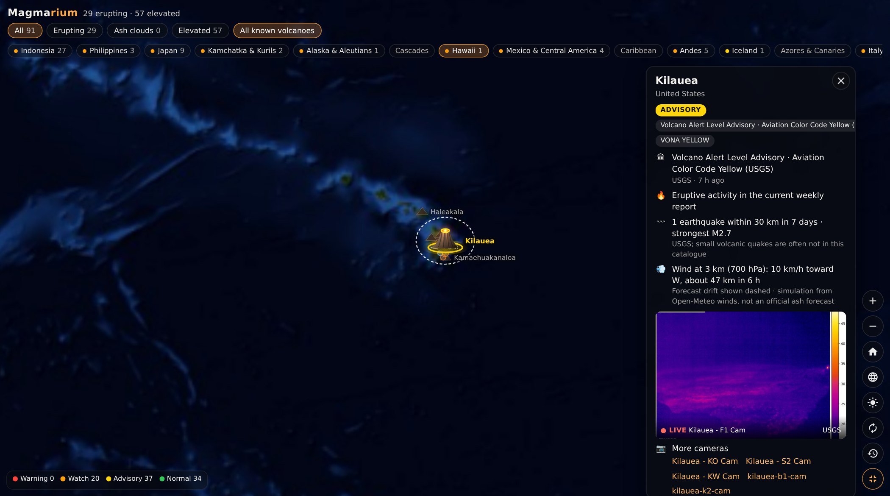
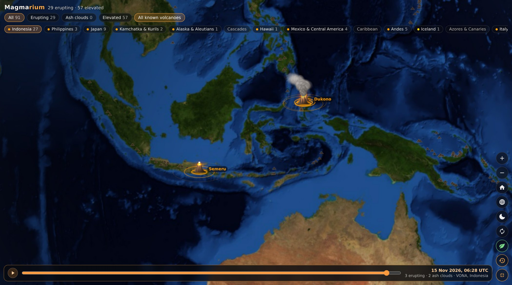
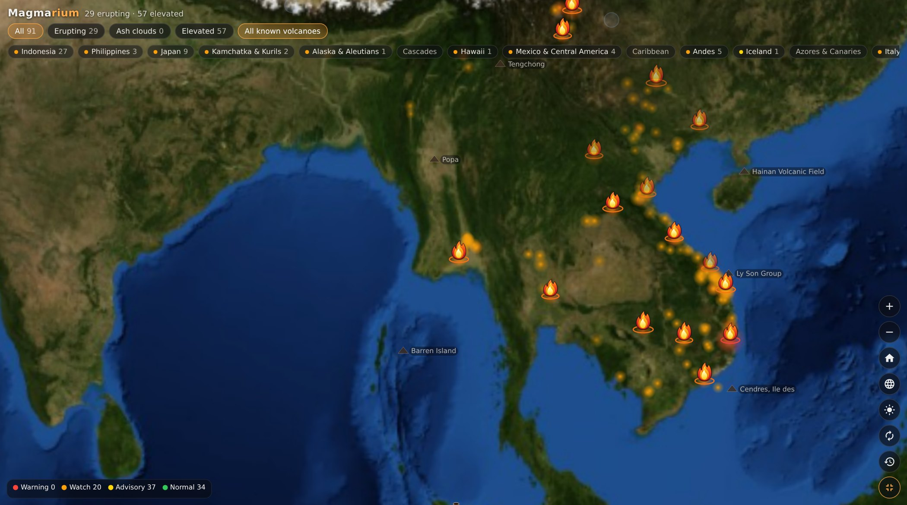
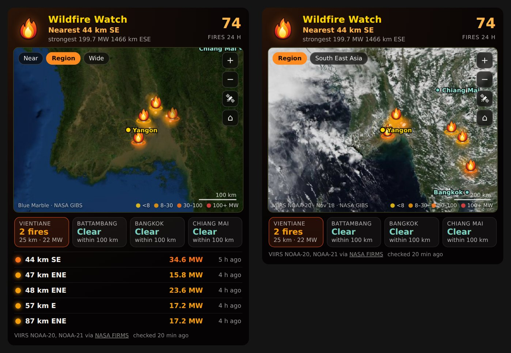
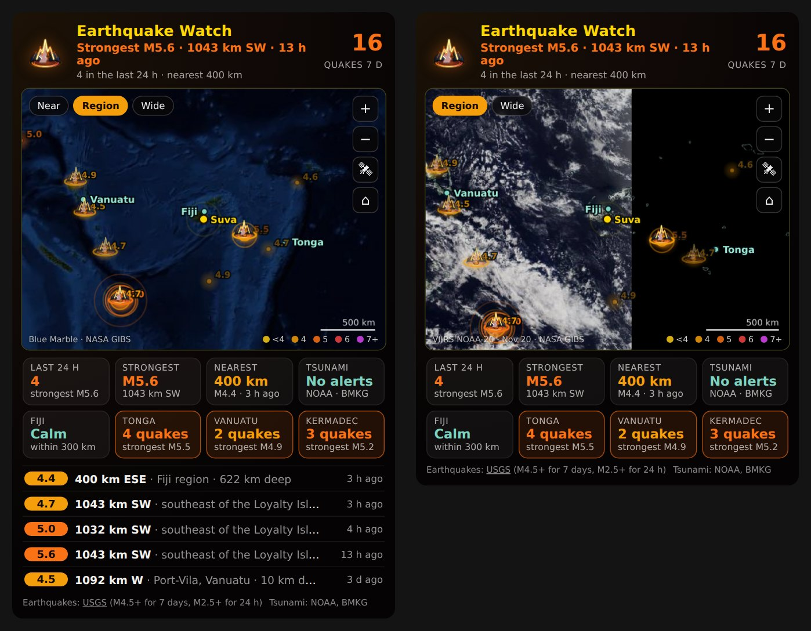
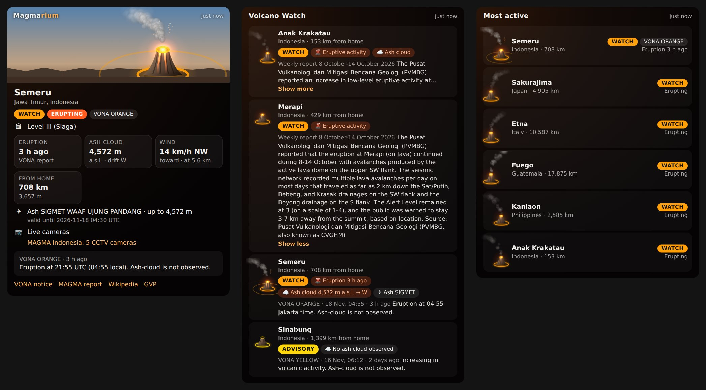

<p align="center">
  <picture>
    <source media="(prefers-color-scheme: dark)" srcset="custom_components/magmarium/brand/dark_logo@2x.png">
    <source media="(prefers-color-scheme: light)" srcset="custom_components/magmarium/brand/logo@2x.png">
    
  </picture>
</p>

<p align="center">
  <a href="https://github.com/hacs/integration"></a>
  
  
  
  <a href="https://ko-fi.com/mb26dev"></a>
</p>

# Magmarium

Active volcanoes on a living globe for Home Assistant. Magmarium shows **every volcano with a current report** on a 3D Earth: coloured by its official alert level, glowing while it erupts, and with **ash plumes that rise and drift exactly as the latest official notice describes**, only while an ash cloud is actually reported.

It starts with the best volcano data there is for Indonesia, the official alert levels and VONA aviation notices from **MAGMA Indonesia**, adds **official alert levels from the USGS, the Icelandic Met Office, the Japan Meteorological Agency and the Italian Civil Protection and INGV**, the **official volcanic ash areas for aviation (SIGMETs)** worldwide, **earthquakes** from the USGS, **tsunami warnings** from NOAA and BMKG and the whole world from the **Smithsonian / USGS Weekly Volcanic Activity Report**. No API key, no account. Optionally, with a free NASA FIRMS key, **satellite hotspots** show glowing lava at the summits and **wildfires** around your home burn on the globe and on a zoomable regional map.

## Worldwide, not only Indonesia

Magmarium started with Indonesia, but it covers every active volcano on Earth. Where an observatory publishes its alert levels, Magmarium reads them directly:

| Region | Official volcano data | Also |
| --- | --- | --- |
| **Indonesia** | MAGMA Indonesia (PVMBG): alert levels and VONA aviation notices | live cameras, BMKG earthquakes, InaTEWS tsunami bulletins |
| **United States** (Alaska, Hawaii, Cascades, Yellowstone ...) | USGS Volcano Hazards Program: alert level and aviation colour code | USGS earthquakes, NOAA tsunami warnings (PTWC, NTWC), AVO live cameras |
| **Iceland** | Icelandic Met Office (IMO): VONA notices and aviation colour code | |
| **Japan** | Japan Meteorological Agency (JMA): volcanic warning levels | JMA live cameras |
| **Italy** (Etna, Stromboli, Campi Flegrei, Vesuvius, Vulcano) | Italian Civil Protection (Dipartimento della Protezione Civile): national alert levels (green, yellow, orange, red). INGV Etna Observatory: VONA aviation notices for Etna and Stromboli | INGV live cameras (Etna, Stromboli, Vulcano), INGV earthquakes (small quakes near volcanoes, e.g. Campi Flegrei), official ash SIGMETs for European airspace |
| **Everywhere else** (Philippines, Kamchatka, Andes, Central America, PNG, New Zealand ...) | Smithsonian / USGS Weekly Volcanic Activity Report | official ash SIGMETs worldwide, earthquakes M4.5+, tsunami warnings, GeoNet cameras in New Zealand |

In Italy two official statements can exist for one volcano: the Civil Protection alert level (hazard on the ground) and the INGV VONA colour code (aviation). The globe shows the higher one and the info box lists both. Ischia, Pantelleria, Colli Albani, Lipari and Panarea have no Civil Protection levels yet; they show up from the weekly report.

## Screenshots



| | |
| --- | --- |
|  |  |
| **Eruption report:** official alert level, VONA notice, ash SIGMET and the simulated ash drift | **Live cameras:** the newest image of the observatory camera, right in the info panel |
|  |  |
| **Ash areas:** official SIGMETs and earthquakes, glowing craters on the night side | **Replay:** the eruptions and ash clouds of the last 90 days |


**Wildfires** (with a free NASA FIRMS key): the fires of the last 24 hours on the globe and in their own card with a zoomable NASA map, your places and the nearest fires





**Earthquakes and tsunamis:** the quakes of the week around home on the same zoomable map, sized and coloured by magnitude, with official tsunami bulletins



**Compact volcano card for the home dashboard:** an animated volcano with its ash plume, the nearest volcanoes with eruption, ash cloud and the latest report (long reports open with "Show more"), or a list of the most active volcanoes, without the globe



<sub>All screenshots are rendered by a GitHub workflow from a real data snapshot (`docs/demo`) with the actual card and NASA imagery. The wildfires are the real fires of the last 24 hours in South East Asia from the public NASA FIRMS files, shown around the place where most of them burn. The earthquakes are the real USGS quakes of the week, around the place on the Ring of Fire where they were strongest.</sub>

## Features

**Lovelace card** `custom:magmarium-card` (installed and registered automatically)

- **Compact volcano card** `custom:magmarium-volcano-card` for the home dashboard: one animated volcano or a list of the most active volcanoes, without the globe

- Globe with real NASA imagery: Blue Marble by day, city lights by night, live day and night terminator
- **Daylight mode** (default): the whole visible globe is lit, nothing lies in the dark; the sun / moon button switches to the real day and night
- Every volcano with a current report drawn as a small 3D cone, ringed in the colour of its alert level (Normal, Advisory, Watch, Warning)
- **Eruptions:** glowing crater, lava running down the flanks and glowing ejecta, stronger on the night side
- **Ash clouds from VONA:** the plume rises to the reported height above the summit, drifts in the reported direction, takes the reported colour (white, grey, black) and density (thin, medium, thick) and fades out within 4 hours. A newer notice without ash makes the old cloud fade faster.
- Ash plumes from the weekly report are drawn lighter, as "reported this week"
- Warning level volcanoes pulse
- All ~1,200 known Holocene volcanoes as small background cones (switchable)
- Tap a volcano for its alert level, aviation colour code, eruption time, ash cloud height and drift, the full notice text and links to the official reports
- Filter chips: all, erupting, ash clouds, elevated
- **Region buttons:** one tap turns the globe to Indonesia, Japan, Iceland, the Andes and twelve more volcanic regions, each with its number of active volcanoes
- **Official ash areas:** volcanic ash SIGMETs drawn as live polygons with height and validity, tap for the full text
- **Earthquakes** of the last 7 days as rings, orange near a volcano, fresh ones pulse
- **Tsunami warnings:** official bulletins of NOAA (PTWC, NTWC) and BMKG InaTEWS roll out as waves from the epicentre, in the colour of the alert (warning, watch, advisory, information), with a banner in the compact card
- **Satellite hotspots** (optional, free NASA FIRMS key): VIIRS thermal anomalies at the summit glow on the ground, with radiative power in MW
- **Wildfires** (same key): satellite fire detections of the last 48 hours around your home, grouped into fires (5 km cells near home, 50 km further away), as animated flames on the globe and in their own **wildfire card** with a zoomable NASA map, your places and the nearest fires
- **Replay:** one button plays the eruptions and ash clouds of the last 90 days (VONA, Indonesia) on the globe
- **Wikipedia link** for every volcano, matched by its Smithsonian number through Wikidata
- **Live cameras:** the newest image of the official observatory camera right in the info panel (USGS, GeoNet), links to the camera pages of the Japan Meteorological Agency and to the MAGMA Indonesia CCTV
- **Visual card editor**, no YAML needed
- **Ash drift simulation:** forecast winds at the height of the ash cloud (Open-Meteo) turn plumes without a reported direction and draw a dashed track of where the ash would drift in the next 6 hours
- **Fullscreen button**, also on phones and in the app (full window where the browser has no fullscreen)
- Drag to turn, mouse wheel or pinch to zoom, double tap to zoom in, optional slow rotation
- Works on phones and wall tablets, pauses itself when it is not on screen

**Sensors**

| Sensor | State | Attributes |
| --- | --- | --- |
| Elevated volcanoes | volcanoes above normal level | count per level, list of volcanoes |
| Erupting volcanoes | volcanoes with a reported eruption (VONA in the last 24 h, or the current weekly report) | list, which ones are live from VONA |
| Ash clouds | ash clouds reported by VONA in the last 4 hours | height, drift direction, intensity per cloud |
| Nearest active volcano | name of the nearest volcano with elevated activity | distance from home, level, eruption, ash cloud |
| Latest VONA | time of the newest VONA (timestamp) | volcano, aviation colour, notice text, ash height, link |
| `<volcano>` | alert level of a watched volcano: normal, advisory, watch, warning | official alert (e.g. *Level III (Siaga)*), aviation colour, eruption, ash cloud, notice, distance |
| Ash SIGMETs | valid volcanic ash SIGMETs worldwide | volcano, flight information region, height, validity, movement |
| Earthquakes near volcanoes | USGS (and in Italy INGV) earthquakes of the last 7 days within 30 km of a volcano | magnitude, depth, distance, volcano |
| Tsunami alerts | tsunami warnings, watches and advisories in force | highest level, nearest distance from home, every bulletin with region, magnitude, sources and link |
| Thermal anomalies (with FIRMS key) | volcanoes with satellite hotspots at the summit in the last 48 h | hotspots, radiative power (MW), satellite pass, distance |
| Earthquakes near home | earthquakes within 2000 km of home in the last 7 days (USGS) | quakes of the last 24 h, strongest and nearest (24 h and 7 days), the 15 newest with magnitude, depth, distance and direction |
| Wildfires (with FIRMS key) | fires around home seen in the last 24 h | nearest distance and direction, strongest fire (MW), fires within 25 / 100 / 300 km, total power, the 25 nearest fires with position, power, detections and last pass |
| Ash near `<place>` (binary) | on when ash comes within the radius of a place | nearest distance, volcano, kind (SIGMET, plume or drift track), hours until the drift track arrives, official |
| Data sources (diagnostic) | ok, degraded or waiting | status of every feed, cache sizes, Earth imagery |

If a source has not answered for 24 hours, Home Assistant shows a repair notice. The last known data stays on the globe, and the notice disappears by itself when the source answers again.

The integration is translated into English and German.

## Installation

### HACS (recommended)

Magmarium is available in the HACS default store.

1. Open **HACS** in Home Assistant, search for **Magmarium** and download it, or use this button:

   [](https://my.home-assistant.io/redirect/hacs_repository/?owner=mb26-dev&repository=ha-magmarium&category=integration)

2. Restart Home Assistant
3. **Settings → Devices & services → Add integration → Magmarium**, or use this button:

   [](https://my.home-assistant.io/redirect/config_flow_start/?domain=magmarium)

<details>
<summary>Not showing up in HACS yet? Add it as a custom repository</summary>

1. HACS → three dots → **Custom repositories** → add `https://github.com/mb26-dev/ha-magmarium`, type **Integration**.
2. Download **Magmarium** and restart Home Assistant.

</details>

If you added this repository as a custom repository before, you can remove that entry; the installed integration and its settings stay as they are.

### Manual

Copy `custom_components/magmarium` into your `config/custom_components` folder and restart Home Assistant.

## Configuration

All settings are done in the UI and can be changed later under **Configure**:

| Option | Default | Description |
| --- | --- | --- |
| Data sources | all | MAGMA Indonesia: official alert levels and VONA notices for all Indonesian volcanoes. Weekly report: worldwide activity from the Smithsonian Global Volcanism Program and USGS. Official alert levels: USGS (US volcanoes), Icelandic Met Office, Japan Meteorological Agency. Ash SIGMETs: official volcanic ash areas for aviation. Earthquakes: USGS. Tsunami warnings: NOAA PTWC / NTWC and BMKG InaTEWS. Italy: Civil Protection alert levels, INGV VONA notices (Etna, Stromboli) and INGV earthquakes. |
| Volcanoes to watch | empty | Comma separated names, e.g. `Semeru, Merapi, Anak Krakatau, Lewotobi`. Each one gets its own sensor. |
| Places to watch for ash | Home | Zones, for example your home and your airports. Each gets an "Ash near ..." sensor. |
| Ash warning radius | 150 km | Distance around each place. |
| NASA FIRMS map key | empty | Optional. A free key from [firms.modaps.eosdis.nasa.gov/api/map_key](https://firms.modaps.eosdis.nasa.gov/api/map_key/) switches on the satellite hotspots (VIIRS) at volcanoes with a raised alert level, an eruption or ash (checked every 3 hours) and the wildfires. |
| Wildfire radius around home | 1500 km | Wildfires within this distance of your home location, checked every hour (needs the FIRMS key). 0 switches them off, 20000 covers the world. |

Update intervals: VONA notices every 10 minutes, MAGMA alert levels every hour, the weekly report every 6 hours, winds aloft every hour (and right away when a new ash cloud or eruption appears, only for those volcanoes), official alert levels every hour (INGV VONA notices every 15 minutes), ash SIGMETs every 15 minutes, earthquakes every 15 minutes with a quick check for new quakes every 2 minutes, tsunami bulletins every 5 minutes, satellite hotspots every 3 hours and wildfires every hour (with a FIRMS key), the volcano catalogue and the Wikipedia links once a month. Every source has its own cache and backoff, so a source that is down never blocks the others, and restarts do not download anything again. The NASA Earth images (about 3 MB) are downloaded once; if [Orbitarium](https://github.com/mb26-dev/ha-orbitarium) is installed, its images are used and nothing is downloaded.

## The card

```yaml
type: custom:magmarium-card
```

All options are optional:

```yaml
type: custom:magmarium-card
title: Magmarium
height: 460            # height in px
center: home           # home, world, ring_of_fire, a region key (see below) or [lat, lon]
zoom: 2.4              # 1 shows the whole globe
regions: true          # region buttons; false hides them, a list picks and orders them
rotate: false          # slow rotation when nobody touches the card
daylight: true         # whole globe lit; false shows the real day and night (the button switches)
show_all: true         # all known volcanoes as small background cones
weekly_ash: true       # light ash plumes for ash reported in the weekly report
wind_tracks: true      # dashed 6 hour ash drift tracks from forecast winds
ash_areas: true        # official volcanic ash areas (SIGMETs)
quakes: true           # earthquakes of the last 7 days
tsunami: true          # tsunami warnings as rolling waves
thermal: true          # satellite hotspots (needs a NASA FIRMS key in the integration)
fires: true            # wildfires around home (same key)
replay: true           # replay button for the last 90 days
cams: true             # live camera images of the observatories
labels: true
performance: auto      # auto, full or eco (see below)
```

### Wall tablets: eco mode

On weak wall tablets the animation can make the device warm or the dashboard sluggish. The **leaf button** on the globe switches to eco mode: 15 instead of 30 frames per second, normal instead of retina pixel density, a lighter Earth image and fewer ash particles. It looks the same from across the room. The choice is remembered **in that browser only**, so the wall tablet can run eco while your desktop stays on full quality, and all Magmarium cards on that device follow it.

`performance: auto` (default) switches to eco by itself on touch devices with few CPU cores, on devices with little memory, or when the globe cannot keep up. `full` and `eco` set it for every device; the leaf button still overrides it per browser. All Magmarium cards also pause their animation when they are not visible (another slide, another view, screen off).

### Compact volcano card

For a quick look on your home dashboard there is a second card without the globe: `custom:magmarium-volcano-card`. Add it from the card picker ("Magmarium Volcano") and pick what to show in the visual editor.

The top shows the volcano as on the globe, animated: glowing crater and lava while it erupts, the ash plume drifting with the reported direction or the wind, glowing ejecta after a fresh VONA, pulse rings at warning level, and a day or night sky for the local time at the volcano.

```yaml
type: custom:magmarium-volcano-card
volcano: auto             # auto = the most active volcano right now, or an id such as gvp:263300
navigation_path: /dashboard-volcanoes/globe   # optional: open the globe on tap
# everything is shown by default, switch off what you don't need:
scene: true               # animated volcano
eruption: true
ash: true
sigmets: true
quakes: true
wind: true
camera: true              # live camera image of the observatory
notice: true              # latest VONA or weekly report
links: true
```

The most active volcanoes as a list, each with its own small animated cone:

```yaml
type: custom:magmarium-volcano-card
volcano: list
count: 5
title: Most active
```

Or your own volcanoes: `volcanoes: [gvp:263300, gvp:282080]` (the editor lists every volcano in the current reports).

The nearest active volcanoes, with eruption, ash cloud, SIGMETs and the latest report in every row:

```yaml
type: custom:magmarium-volcano-card
volcano: list
sort: distance            # nearest first, from your home location (default: activity)
details: true             # eruption, ash cloud, SIGMETs, quakes and report text per row
text_lines: 3             # long reports: lines before "Show more" (0 = always the full text)
count: 5
title: Volcano Watch
```

### Wildfire card

`custom:magmarium-fire-card` watches the fires around your home on a zoomable map: NASA Blue Marble relief, or with the 🛰 button today's VIIRS satellite image (you can see the smoke when there are no clouds). Every fire glows in the colour of its power, the strongest get the animated flame; tap one for distance, power, satellite passes and a link to the NASA FIRMS map. Below the map: a tile per place with its fires, an optional air quality tile and the nearest fires.

```yaml
type: custom:magmarium-fire-card
title: Wildfire Watch
home_name: Home
height: 260
hours: 48                 # fires of the last hours on the map (the list and the tiles use 24 h)
list: 5                   # nearest fires below the map (0 hides the list)
map: relief               # or satellite
air_quality_entity: sensor.pm2_5   # optional PM2.5 sensor as a tile
places:                   # optional: a tile per place, fires within radius_km
  - name: Old Town
    lat: 50.08
    lon: 14.42
    radius_km: 30
views:                    # map buttons; lat / lon default to home
  - name: Near
    radius_km: 40
  - name: Region
    radius_km: 150
  - name: Wide
    radius_km: 900
view: 1                   # the button shown first
```

The map tiles come straight from NASA GIBS in your browser; Home Assistant only downloads the fire detections.

### Earthquake card

`custom:magmarium-quake-card` shows the earthquakes around your home on the same map: rings and colours by magnitude, seismic waves for the last 24 hours, the shaking marker on the strongest ones, tsunami bulletins in force with their waves and a banner. Tiles for the last 24 hours, the strongest and the nearest quake, tsunami status and your places; a list of the newest quakes with distance, direction and depth.

```yaml
type: custom:magmarium-quake-card
title: Earthquake Watch
radius_km: 2000           # quakes within this distance of home
days: 7                   # up to 7 (USGS: M4.5+ for 7 days, M2.5+ for the last day)
min_magnitude: 0
list: 5
places: []                # like the wildfire card
views:                    # like the wildfire card
  - name: Near
    radius_km: 300
  - name: Region
    radius_km: 900
```

### Region buttons

A second row of buttons flies the globe to a volcanic region. Each button shows how many volcanoes there are currently active, with a dot in the colour of the highest alert level; quiet regions are dimmed. Once a region is zoomed in, the quiet volcanoes are labelled too.

| Key | Region |
|---|---|
| `indonesia` | Indonesia |
| `philippines` | Philippines |
| `japan` | Japan |
| `kamchatka` | Kamchatka & Kurils |
| `alaska` | Alaska & Aleutians |
| `cascades` | Cascades |
| `hawaii` | Hawaii |
| `central_america` | Mexico & Central America |
| `caribbean` | Caribbean |
| `andes` | Andes |
| `iceland` | Iceland |
| `atlantic` | Azores & Canaries |
| `mediterranean` | Italy & Mediterranean |
| `east_africa` | East Africa |
| `melanesia` | PNG & Vanuatu |
| `new_zealand` | New Zealand & Tonga |

Only some of them, in your order:

```yaml
type: custom:magmarium-card
center: indonesia
regions: [indonesia, philippines, japan, iceland, mediterranean]
```

Every option can also be set in the visual card editor.

## Alert notifications (blueprints)

[](https://my.home-assistant.io/redirect/blueprint_import/?blueprint_url=https%3A%2F%2Fgithub.com%2Fmb26-dev%2Fha-magmarium%2Fblob%2Fmain%2Fblueprints%2Fautomation%2Fmagmarium%2Falert_level_change.yaml)

Pick a watched volcano and what should happen. The actions get the variables `volcano`, `level`, `previous`, `alert`, `ash_top_m`, `ash_moving_to`, `text` and `url`, for example:

```yaml
- action: notify.notify
  data:
    title: "{{ volcano }}: {{ level }}"
    message: "{{ alert }}. {{ text }}"
```

**Ash near a place**

[](https://my.home-assistant.io/redirect/blueprint_import/?blueprint_url=https%3A%2F%2Fgithub.com%2Fmb26-dev%2Fha-magmarium%2Fblob%2Fmain%2Fblueprints%2Fautomation%2Fmagmarium%2Fash_near_place.yaml)

Pick an "Ash near ..." sensor, for example of your home or your airport. Optionally only official ash areas count. The actions get `place`, `volcano`, `kind`, `distance_km`, `eta_hours` and `official`.

**Eruption or tsunami near you**

[](https://my.home-assistant.io/redirect/blueprint_import/?blueprint_url=https%3A%2F%2Fgithub.com%2Fmb26-dev%2Fha-magmarium%2Fblob%2Fmain%2Fblueprints%2Fautomation%2Fmagmarium%2Feruption_tsunami_near_you.yaml)

Pick the "Erupting volcanoes" and the "Tsunami alerts" sensors, a radius for eruptions and one for tsunamis, and the lowest tsunami level. It runs when a volcano within your radius gets a new VONA eruption notice or when a new tsunami bulletin comes in near you. The actions get `title` and `message`, for example:

```yaml
- action: notify.notify
  data:
    title: "{{ title }}"
    message: "{{ message }}"
```

## How it reads the reports

| Shown on the globe | Comes from |
| --- | --- |
| Colour of the ring | Indonesia: official MAGMA alert level (Level I Normal, II Waspada, III Siaga, IV Awas). US volcanoes: USGS alert level and aviation colour code. Iceland: aviation colour code of the Icelandic Met Office. Japan: JMA alert level (levels 4 and 5 both show as Warning). Italy: Civil Protection alert level or INGV VONA colour code, the higher one. Elsewhere: the weekly report (new eruptive activity = Watch, unrest or ongoing activity = Advisory). |
| Grey dashed area | a valid volcanic ash SIGMET: the official ash area for aviation. A volcano named in it gets an ash plume moving in the SIGMET direction. |
| Rings | USGS earthquakes of the last 7 days; orange within 30 km of a volcano. Small volcanic quakes, for example in Indonesia, are often not in this catalogue. In Italy the INGV catalogue is used: M2+ near a volcano, M3+ elsewhere. |
| Coloured waves from a point | a tsunami bulletin in force (NOAA PTWC / NTWC, BMKG InaTEWS): red warning or threat, orange watch, yellow advisory, blue information statement. The waves only mark the event, they are not a forecast of the tsunami. |
| Hot glow on the ground | satellite hotspots of the last 48 hours within 5 km of the summit (NASA FIRMS, VIIRS); brighter with more radiative power |
| Flames and glowing embers | wildfires around home of the last 48 hours (NASA FIRMS, VIIRS): yellow under 8 MW, amber 8 to 30, orange 30 to 100, red above 100 MW. Older fires fade. Hotspots within 5 km of a volcano count as volcanic heat, not as wildfires. Clouds can hide fires, small or short fires can be missed. |
| Glowing crater and lava | a VONA in the last 24 hours that reports an eruption, or eruptive activity in the current weekly report |
| Ash plume | a VONA in the last 4 hours with an ash cloud: height above the summit, drift direction, ash colour and intensity are taken from the notice. Exercise notices (*VA EXERCISE*) are ignored. |
| Light ash plume | ash plumes mentioned in the current weekly report |
| Drift direction of a plume | the direction in the notice; when a notice has none (always for the weekly report), the forecast wind at the height of the ash cloud |
| Dashed drift track | a simulation: the hourly forecast wind at the volcano, at the pressure level nearest to the reported (or estimated) ash cloud top, followed for 6 hours. Shown for every plume and for a selected erupting volcano. |

Ash clouds and eruptions on the globe are illustrations of the official reports, not measurements or forecasts. For aviation or safety decisions always use the official sources.

## Support

If Magmarium makes your dashboard erupt, a coffee keeps the lava flowing. ☕🌋

<a href="https://ko-fi.com/mb26dev"></a>

A star on GitHub, a bug report or a screenshot of your dashboard helps just as much. Thank you!

## Credits

- Volcano alert levels and VONA notices for Indonesia: [MAGMA Indonesia](https://magma.esdm.go.id), PVMBG / CVGHM, Geological Agency of Indonesia
- Weekly Volcanic Activity Report and Volcanoes of the World: [Smithsonian Institution Global Volcanism Program](https://volcano.si.edu) and [USGS](https://www.usgs.gov/programs/VHP)
- Official alert levels: [USGS Volcano Hazards Program](https://volcanoes.usgs.gov) (HANS), [Icelandic Met Office](https://en.vedur.is), [Japan Meteorological Agency](https://www.jma.go.jp)
- Italy: alert levels of the [Dipartimento della Protezione Civile](https://mappe.protezionecivile.gov.it/it/mappe-e-dashboard-rischi/mappa-livelli-di-allerta-vulcani-italia/) (data from [pcm-dpc/DPC-Mappe](https://github.com/pcm-dpc/DPC-Mappe)), VONA notices of the [INGV Osservatorio Etneo](https://www.ct.ingv.it) and earthquakes of the [INGV](https://terremoti.ingv.it)
- Volcanic ash SIGMETs: [AviationWeather.gov](https://aviationweather.gov) (NOAA Aviation Weather Center)
- Earthquakes: [USGS Earthquake Hazards Program](https://earthquake.usgs.gov)
- Tsunami warnings: [NOAA Tsunami Warning Centers](https://www.tsunami.gov) (PTWC, NTWC) and [BMKG InaTEWS](https://inatews.bmkg.go.id)
- Satellite hotspots and wildfires: [NASA FIRMS](https://firms.modaps.eosdis.nasa.gov) (VIIRS, LANCE / EOSDIS)
- Wildfire map tiles: [NASA GIBS](https://www.earthdata.nasa.gov/engage/open-data-services-software/earthdata-developer-portal/gibs-api) (Blue Marble shaded relief, VIIRS NOAA-20 corrected reflectance, coastlines)
- Tsunami, wildfire and earthquake icons: designed for Magmarium by mb26-dev
- Wikipedia links: [Wikidata](https://www.wikidata.org) (CC0)
- Volcano cameras: [USGS Volcano Hazards Program AshCam](https://avo-volcview.wr.usgs.gov/ashcam-gui/webcam.html), [GeoNet / GNS Science](https://www.geonet.org.nz/volcano/cameras), [Japan Meteorological Agency](https://www.data.jma.go.jp/vois/data/obs/volcam/volcam.php), [MAGMA Indonesia](https://magma.esdm.go.id/v1/gunung-api/cctv), [INGV Osservatorio Etneo](https://www.ct.ingv.it/index.php/monitoraggio-e-sorveglianza/segnali-in-tempo-reale/video-sorveglianza-vulcanica-etna) (Etna, Stromboli, Vulcano)
- Winds aloft: [Open-Meteo](https://open-meteo.com) (CC BY 4.0)
- Earth imagery: NASA Earth Observatory, [Blue Marble Next Generation](https://science.nasa.gov/earth/earth-observatory/blue-marble-next-generation/) by Reto Stöckli and [Black Marble 2016](https://science.nasa.gov/earth/earth-observatory/earth-at-night/maps)
- Volcano, lava and ash drawings are original artwork rendered in the card

See [THIRD_PARTY_NOTICES.md](THIRD_PARTY_NOTICES.md) for details.
