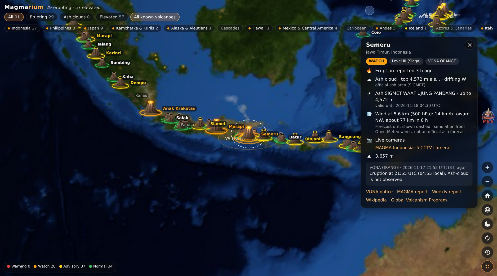
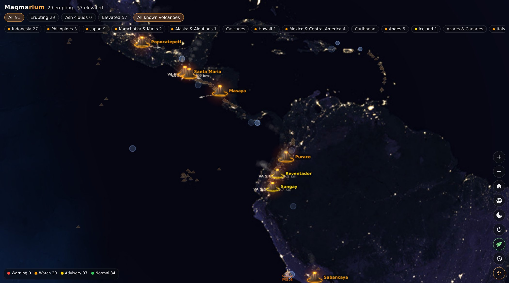
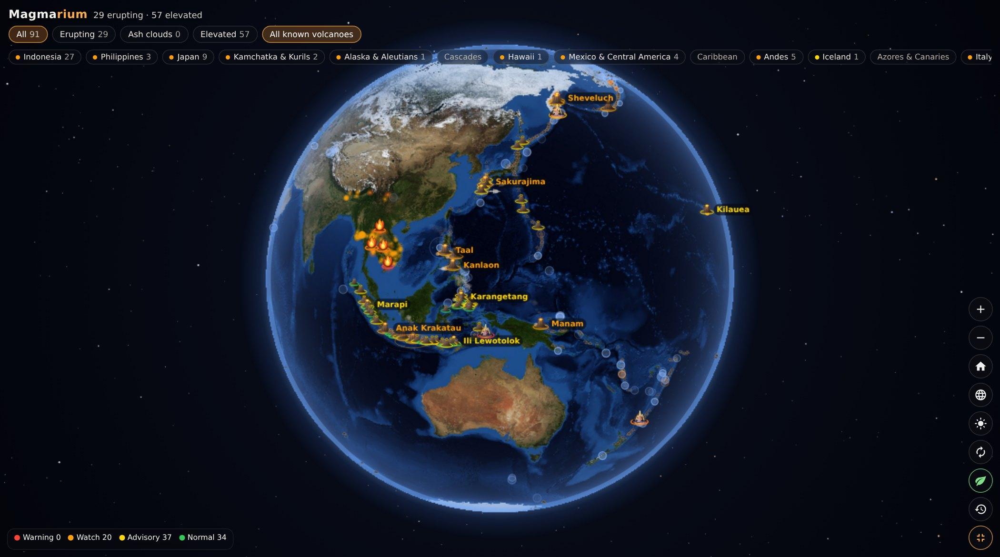

<p align="center">
  <picture>
    <source media="(prefers-color-scheme: dark)" srcset="custom_components/magmarium/brand/dark_logo@2x.png">
    <source media="(prefers-color-scheme: light)" srcset="custom_components/magmarium/brand/logo@2x.png">
    
  </picture>
</p>

<p align="center">
  <a href="https://github.com/hacs/integration"></a>
  
  
  
  <a href="https://ko-fi.com/mb26dev"></a>
</p>

# Magmarium

Active volcanoes on a living globe for Home Assistant. Magmarium shows **every volcano with a current report** on a 3D Earth: coloured by its official alert level, glowing while it erupts, and with **ash plumes that rise and drift exactly as the latest official notice describes**, only while an ash cloud is actually reported.

It starts with the best volcano data there is for Indonesia, the official alert levels and VONA aviation notices from **MAGMA Indonesia**, adds **official alert levels from the USGS, the Icelandic Met Office and the Japan Meteorological Agency**, the **official volcanic ash areas for aviation (SIGMETs)** worldwide, **earthquakes** from the USGS and the whole world from the **Smithsonian / USGS Weekly Volcanic Activity Report**. No API key, no account.

## Screenshots


| | |
| --- | --- |
|  |  |
| **Eruption report:** official alert level, VONA notice, ash SIGMET and the simulated ash drift | **Live cameras:** the newest image of the observatory camera, right in the info panel |
|  |  |
| **Ash areas:** official SIGMETs and earthquakes, glowing craters on the night side | **Replay:** the eruptions and ash clouds of the last 90 days |



<sub>Screenshots are rendered by a GitHub workflow from a real data snapshot (`docs/demo`) with the actual card and NASA imagery.</sub>

## Features

**Lovelace card** `custom:magmarium-card` (installed and registered automatically)

- Globe with real NASA imagery: Blue Marble by day, city lights by night, live day and night terminator
- Every volcano with a current report drawn as a small 3D cone, ringed in the colour of its alert level (Normal, Advisory, Watch, Warning)
- **Eruptions:** glowing crater, lava running down the flanks and glowing ejecta, stronger on the night side
- **Ash clouds from VONA:** the plume rises to the reported height above the summit, drifts in the reported direction, takes the reported colour (white, grey, black) and density (thin, medium, thick) and fades out within 4 hours. A newer notice without ash makes the old cloud fade faster.
- Ash plumes from the weekly report are drawn lighter, as "reported this week"
- Warning level volcanoes pulse
- All ~1,200 known Holocene volcanoes as small background cones (switchable)
- Tap a volcano for its alert level, aviation colour code, eruption time, ash cloud height and drift, the full notice text and links to the official reports
- Filter chips: all, erupting, ash clouds, elevated
- **Region buttons:** one tap turns the globe to Indonesia, Japan, Iceland, the Andes and twelve more volcanic regions, each with its number of active volcanoes
- **Official ash areas:** volcanic ash SIGMETs drawn as live polygons with height and validity, tap for the full text
- **Earthquakes** of the last 7 days as rings, orange near a volcano, fresh ones pulse
- **Replay:** one button plays the eruptions and ash clouds of the last 90 days (VONA, Indonesia) on the globe
- **Wikipedia link** for every volcano, matched by its Smithsonian number through Wikidata
- **Live cameras:** the newest image of the official observatory camera right in the info panel (USGS, GeoNet), links to the camera pages of the Japan Meteorological Agency and to the MAGMA Indonesia CCTV
- **Visual card editor**, no YAML needed
- **Ash drift simulation:** forecast winds at the height of the ash cloud (Open-Meteo) turn plumes without a reported direction and draw a dashed track of where the ash would drift in the next 6 hours
- **Fullscreen button**, also on phones and in the app (full window where the browser has no fullscreen)
- Drag to turn, mouse wheel or pinch to zoom, double tap to zoom in, optional slow rotation
- Works on phones and wall tablets, pauses itself when it is not on screen

**Sensors**

| Sensor | State | Attributes |
| --- | --- | --- |
| Elevated volcanoes | volcanoes above normal level | count per level, list of volcanoes |
| Erupting volcanoes | volcanoes with a reported eruption (VONA in the last 24 h, or the current weekly report) | list, which ones are live from VONA |
| Ash clouds | ash clouds reported by VONA in the last 4 hours | height, drift direction, intensity per cloud |
| Nearest active volcano | name of the nearest volcano with elevated activity | distance from home, level, eruption, ash cloud |
| Latest VONA | time of the newest VONA (timestamp) | volcano, aviation colour, notice text, ash height, link |
| `<volcano>` | alert level of a watched volcano: normal, advisory, watch, warning | official alert (e.g. *Level III (Siaga)*), aviation colour, eruption, ash cloud, notice, distance |
| Ash SIGMETs | valid volcanic ash SIGMETs worldwide | volcano, flight information region, height, validity, movement |
| Earthquakes near volcanoes | USGS earthquakes of the last 7 days within 30 km of a volcano | magnitude, depth, distance, volcano |
| Ash near `<place>` (binary) | on when ash comes within the radius of a place | nearest distance, volcano, kind (SIGMET, plume or drift track), hours until the drift track arrives, official |
| Data sources (diagnostic) | ok, degraded or waiting | status of every feed, cache sizes, Earth imagery |

If a source has not answered for 24 hours, Home Assistant shows a repair notice. The last known data stays on the globe, and the notice disappears by itself when the source answers again.

The integration is translated into English and German.

## Installation

### HACS (custom repository)

1. HACS → three dots → **Custom repositories** → add `https://github.com/mb26-dev/ha-magmarium` as **Integration**, or use this button:

   [](https://my.home-assistant.io/redirect/hacs_repository/?owner=mb26-dev&repository=ha-magmarium&category=integration)

2. Download **Magmarium** and restart Home Assistant
3. **Settings → Devices & services → Add integration → Magmarium**, or use this button:

   [](https://my.home-assistant.io/redirect/config_flow_start/?domain=magmarium)

### Manual

Copy `custom_components/magmarium` into your `config/custom_components` folder and restart Home Assistant.

## Configuration

All settings are done in the UI and can be changed later under **Configure**:

| Option | Default | Description |
| --- | --- | --- |
| Data sources | all | MAGMA Indonesia: official alert levels and VONA notices for all Indonesian volcanoes. Weekly report: worldwide activity from the Smithsonian Global Volcanism Program and USGS. Official alert levels: USGS (US volcanoes), Icelandic Met Office, Japan Meteorological Agency. Ash SIGMETs: official volcanic ash areas for aviation. Earthquakes: USGS. |
| Volcanoes to watch | empty | Comma separated names, e.g. `Semeru, Merapi, Anak Krakatau, Lewotobi`. Each one gets its own sensor. |
| Places to watch for ash | Home | Zones, for example your home and your airports. Each gets an "Ash near ..." sensor. |
| Ash warning radius | 150 km | Distance around each place. |

Update intervals: VONA notices every 10 minutes, MAGMA alert levels every hour, the weekly report every 6 hours, winds aloft every hour (and right away when a new ash cloud or eruption appears, only for those volcanoes), official alert levels every hour, ash SIGMETs and earthquakes every 15 minutes, the volcano catalogue and the Wikipedia links once a month. Every source has its own cache and backoff, so a source that is down never blocks the others, and restarts do not download anything again. The NASA Earth images (about 3 MB) are downloaded once; if [Orbitarium](https://github.com/mb26-dev/ha-orbitarium) is installed, its images are used and nothing is downloaded.

## The card

```yaml
type: custom:magmarium-card
```

All options are optional:

```yaml
type: custom:magmarium-card
title: Magmarium
height: 460            # height in px
center: home           # home, world, ring_of_fire, a region key (see below) or [lat, lon]
zoom: 2.4              # 1 shows the whole globe
regions: true          # region buttons; false hides them, a list picks and orders them
rotate: false          # slow rotation when nobody touches the card
show_all: true         # all known volcanoes as small background cones
weekly_ash: true       # light ash plumes for ash reported in the weekly report
wind_tracks: true      # dashed 6 hour ash drift tracks from forecast winds
ash_areas: true        # official volcanic ash areas (SIGMETs)
quakes: true           # earthquakes of the last 7 days
replay: true           # replay button for the last 90 days
cams: true             # live camera images of the observatories
labels: true
```

### Region buttons

A second row of buttons flies the globe to a volcanic region. Each button shows how many volcanoes there are currently active, with a dot in the colour of the highest alert level; quiet regions are dimmed. Once a region is zoomed in, the quiet volcanoes are labelled too.

| Key | Region |
|---|---|
| `indonesia` | Indonesia |
| `philippines` | Philippines |
| `japan` | Japan |
| `kamchatka` | Kamchatka & Kurils |
| `alaska` | Alaska & Aleutians |
| `cascades` | Cascades |
| `hawaii` | Hawaii |
| `central_america` | Mexico & Central America |
| `caribbean` | Caribbean |
| `andes` | Andes |
| `iceland` | Iceland |
| `atlantic` | Azores & Canaries |
| `mediterranean` | Italy & Mediterranean |
| `east_africa` | East Africa |
| `melanesia` | PNG & Vanuatu |
| `new_zealand` | New Zealand & Tonga |

Only some of them, in your order:

```yaml
type: custom:magmarium-card
center: indonesia
regions: [indonesia, philippines, japan, iceland, mediterranean]
```

Every option can also be set in the visual card editor.

## Alert notifications (blueprints)

[](https://my.home-assistant.io/redirect/blueprint_import/?blueprint_url=https%3A%2F%2Fgithub.com%2Fmb26-dev%2Fha-magmarium%2Fblob%2Fmain%2Fblueprints%2Fautomation%2Fmagmarium%2Falert_level_change.yaml)

Pick a watched volcano and what should happen. The actions get the variables `volcano`, `level`, `previous`, `alert`, `ash_top_m`, `ash_moving_to`, `text` and `url`, for example:

```yaml
- action: notify.notify
  data:
    title: "{{ volcano }}: {{ level }}"
    message: "{{ alert }}. {{ text }}"
```

**Ash near a place**

[](https://my.home-assistant.io/redirect/blueprint_import/?blueprint_url=https%3A%2F%2Fgithub.com%2Fmb26-dev%2Fha-magmarium%2Fblob%2Fmain%2Fblueprints%2Fautomation%2Fmagmarium%2Fash_near_place.yaml)

Pick an "Ash near ..." sensor, for example of your home or your airport. Optionally only official ash areas count. The actions get `place`, `volcano`, `kind`, `distance_km`, `eta_hours` and `official`.

## How it reads the reports

| Shown on the globe | Comes from |
| --- | --- |
| Colour of the ring | Indonesia: official MAGMA alert level (Level I Normal, II Waspada, III Siaga, IV Awas). US volcanoes: USGS alert level and aviation colour code. Iceland: aviation colour code of the Icelandic Met Office. Japan: JMA alert level (levels 4 and 5 both show as Warning). Elsewhere: the weekly report (new eruptive activity = Watch, unrest or ongoing activity = Advisory). |
| Grey dashed area | a valid volcanic ash SIGMET: the official ash area for aviation. A volcano named in it gets an ash plume moving in the SIGMET direction. |
| Rings | USGS earthquakes of the last 7 days; orange within 30 km of a volcano. Small volcanic quakes, for example in Indonesia, are often not in this catalogue. |
| Glowing crater and lava | a VONA in the last 24 hours that reports an eruption, or eruptive activity in the current weekly report |
| Ash plume | a VONA in the last 4 hours with an ash cloud: height above the summit, drift direction, ash colour and intensity are taken from the notice. Exercise notices (*VA EXERCISE*) are ignored. |
| Light ash plume | ash plumes mentioned in the current weekly report |
| Drift direction of a plume | the direction in the notice; when a notice has none (always for the weekly report), the forecast wind at the height of the ash cloud |
| Dashed drift track | a simulation: the hourly forecast wind at the volcano, at the pressure level nearest to the reported (or estimated) ash cloud top, followed for 6 hours. Shown for every plume and for a selected erupting volcano. |

Ash clouds and eruptions on the globe are illustrations of the official reports, not measurements or forecasts. For aviation or safety decisions always use the official sources.

## Support

If Magmarium makes your dashboard erupt, a coffee keeps the lava flowing. ☕🌋

<a href="https://ko-fi.com/mb26dev"></a>

A star on GitHub, a bug report or a screenshot of your dashboard helps just as much. Thank you!

## Credits

- Volcano alert levels and VONA notices for Indonesia: [MAGMA Indonesia](https://magma.esdm.go.id), PVMBG / CVGHM, Geological Agency of Indonesia
- Weekly Volcanic Activity Report and Volcanoes of the World: [Smithsonian Institution Global Volcanism Program](https://volcano.si.edu) and [USGS](https://www.usgs.gov/programs/VHP)
- Official alert levels: [USGS Volcano Hazards Program](https://volcanoes.usgs.gov) (HANS), [Icelandic Met Office](https://en.vedur.is), [Japan Meteorological Agency](https://www.jma.go.jp)
- Volcanic ash SIGMETs: [AviationWeather.gov](https://aviationweather.gov) (NOAA Aviation Weather Center)
- Earthquakes: [USGS Earthquake Hazards Program](https://earthquake.usgs.gov)
- Wikipedia links: [Wikidata](https://www.wikidata.org) (CC0)
- Volcano cameras: [USGS Volcano Hazards Program AshCam](https://avo-volcview.wr.usgs.gov/ashcam-gui/webcam.html), [GeoNet / GNS Science](https://www.geonet.org.nz/volcano/cameras), [Japan Meteorological Agency](https://www.data.jma.go.jp/vois/data/obs/volcam/volcam.php), [MAGMA Indonesia](https://magma.esdm.go.id/v1/gunung-api/cctv)
- Winds aloft: [Open-Meteo](https://open-meteo.com) (CC BY 4.0)
- Earth imagery: NASA Earth Observatory, [Blue Marble Next Generation](https://science.nasa.gov/earth/earth-observatory/blue-marble-next-generation/) by Reto Stöckli and [Black Marble 2016](https://science.nasa.gov/earth/earth-observatory/earth-at-night/maps)
- Volcano, lava and ash drawings are original artwork rendered in the card

See [THIRD_PARTY_NOTICES.md](THIRD_PARTY_NOTICES.md) for details.
